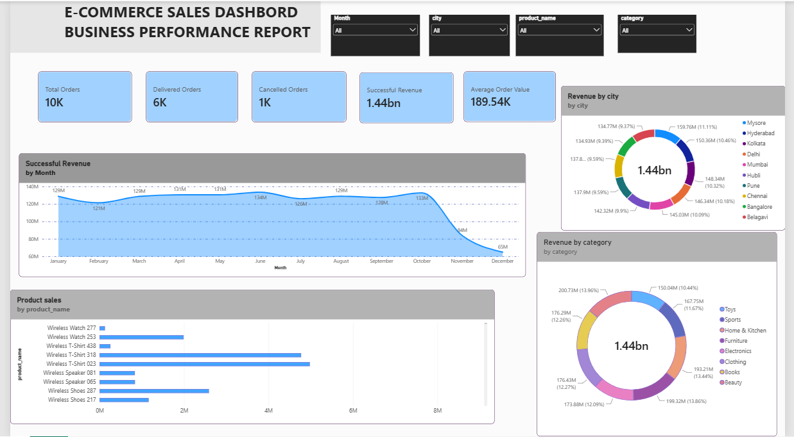

# E-commerce Sales Analysis

## Project Overview
This project analyzes e-commerce sales
data using SQL and Power BI.

## Power BI Dashboard Review

## Filles included
-- customers.csv
-- orders.csv
-- order_items.csv
-- payments.csv
-- products.csv
-- ecommerce_sales and customer Analytics.sql
-- Ecommercce Business Performance Report.pbix
-- dashboard.png

## Tools Used
-- SQL
-- Power BI
-- DAX

## Project Tasks
-- Created relational database tables.
-- performed data validation and cleaning.
-- Analyzed sales and customers data using SQL.
-- Used joins, CTEs subqueries, and window functions.
-- Created DAX measures in Power BI.
-- Developed interactive business performance dashboard.

## Key Business KPIs
-- Total Orders
-- Delivered Orders
-- Cancelled Orders
-- Successuful Revenue
-- Average Order Value
-- Monthly Revenue Trends
-- Top 10 Products
-- Revenue by Category
-- Revenue by city

## Project Files
-- SQL queries
-- CSV datasets
-- Power BI report(.pbx)
-- Dashboard Screenshot

## Business Outcomes
Developed a business performance report to help understand sales trends,product performance,and customer behavior

## Author
Data Analytics Project

